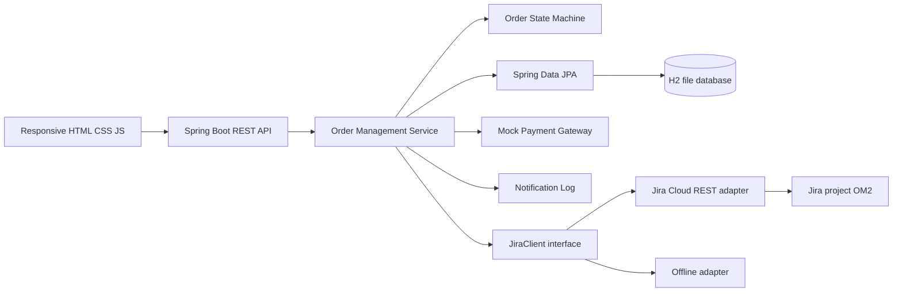

# Contra Order Management and Safe Feature Rollout

College project for Agile Software Development (CSET455), Team Contra. The application demonstrates the order lifecycle and ties release readiness to Jira delivery work.

## Run locally

Requirements: Java 17 and Maven 3.9 or later.

```sh
cp .env.example .env   # optional; keep real values only in this ignored file
./scripts/start.sh
```

The script starts the Spring Boot app on port 8080, creates the H2 file database under `data/`, seeds the catalog, and enables a demo order that is progressed through delivery. Open [http://localhost:8080](http://localhost:8080). API docs are at [http://localhost:8080/swagger-ui.html](http://localhost:8080/swagger-ui.html). Set `DEMO_MODE=false` to disable demo order creation. The demo runner is idempotent for `demo@contra.test`.

To run tests:

```sh
mvn test
```

## Environment variables

| Variable | Purpose | Default |
| --- | --- | --- |
| `SERVER_PORT` | HTTP port | `8080` |
| `DB_FILE` | H2 database file prefix | `./data/oms` |
| `MAX_PAYMENT_RETRIES` | Maximum retry count | `3` |
| `STUCK_ORDER_HOURS` | Time before a nonterminal order is considered stuck | `24` |
| `JIRA_BASE_URL` | Jira Cloud site URL | unset (offline adapter) |
| `JIRA_EMAIL` | Jira account email for runtime REST calls | unset |
| `JIRA_API_TOKEN` | Jira API token for runtime REST calls | unset |
| `JIRA_PROJECT_KEY` | Project used for status reads and operational bugs | `OM2` |
| `DEMO_MODE` | Create a demo order on first startup | `false` (the start script defaults it to `true`) |

Generate an Atlassian API token in your account security settings only if you want the running app to query Jira. Put values in `.env`; never commit that file. Project/backlog setup itself was done in the visible Jira browser. The optional version/sprint REST fallback supports `--dry-run` and uses the same `JIRA_*` variables.

## Jira setup and integration

- Read [`docs/spec.md`](docs/spec.md) and [`jira/seed.json`](jira/seed.json) for the canonical specification and desired backlog.
- [`jira/rest-fallback.py`](jira/rest-fallback.py) can create missing release versions and sprint goals. Run `python3 jira/rest-fallback.py --dry-run` first.
- Runtime Jira calls use `JiraClient`; the offline implementation returns empty integration data and never prevents order operations.
- Admin APIs include `/api/admin/jira/dashboard` and `/api/admin/jira/readiness?version=v1.0`.
- The admin screen shows sprint progress and release readiness. An enabled flag can be switched off at any time; enabling requires both linked Jira issues to be Done.
- Payment failures after the configured retries and old stuck orders create deduplicated Jira Bugs when Jira credentials are configured.

## Architecture



## Evidence screenshots

Capture these for the submission; the exact target pages are listed in [`docs/evidence-checklist.md`](docs/evidence-checklist.md):

- Jira backlog and board, sprint report, release versions, and dependency links.
- Shop, customer order timeline, admin operations, release readiness, and an auto-created Jira Bug.

## Project documents

- [`docs/product-backlog.md`](docs/product-backlog.md) — MoSCoW stories and estimates.
- [`docs/sprint-plan.md`](docs/sprint-plan.md) — planned sprint goals and scope.
- [`docs/definition-of-done.md`](docs/definition-of-done.md) — release checklist.
- [`docs/demo-script.md`](docs/demo-script.md) — five-minute walkthrough.
- [`docs/test-report.md`](docs/test-report.md) — test cases and recorded results.
- [`docs/submission-1-mapping.md`](docs/submission-1-mapping.md) — problem, gap, and client findings mapping.
- [`docs/jira-setup-status.md`](docs/jira-setup-status.md) — live Jira setup status and known gaps.
