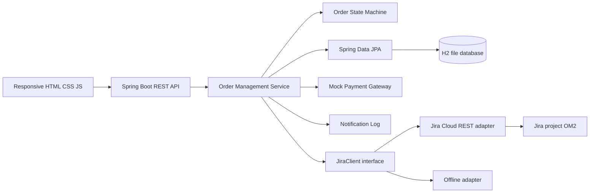

# Contra Order Management and Safe Feature Rollout

College project for Agile Software Development (CSET455), Team Contra. The application demonstrates the order lifecycle and ties release readiness to Jira delivery work.

## Run locally

Requirements: Java 17 or later and Maven 3.8 or later. The launcher will tell you if either is missing.

```sh
cp .env.example .env   # optional; keep real values only in this ignored file
./scripts/start.sh
```

The one-command launcher checks Java and Maven, creates the H2 file database under `data/`, seeds a clearly identified local sample catalog, and (with `DEMO_MODE=true`) progresses a clearly identified local demo order with tracking. These fixtures are not real client or customer data; Jira status reports use observed project data. Open [http://localhost:8080](http://localhost:8080). API docs are at [http://localhost:8080/swagger-ui.html](http://localhost:8080/swagger-ui.html). Leave the terminal open and press Ctrl+C to stop. Set `DEMO_MODE=false` to disable demo order creation. The demo runner is idempotent for `demo@contra.test`. Follow [`docs/antigravity-first-run.md`](docs/antigravity-first-run.md) for first-time installation, setup, and verification, and [`docs/demo-script.md`](docs/demo-script.md) for the teacher walkthrough and reset steps.

To run tests:

```sh
mvn test
```

## Environment variables

| Variable | Purpose | Default |
| --- | --- | --- |
| `SERVER_PORT` | HTTP port | `8080` |
| `DB_FILE` | H2 database file prefix | `./data/oms` |
| `MAX_PAYMENT_RETRIES` | Maximum retry count | `3` |
| `STUCK_ORDER_HOURS` | Time before a nonterminal order is considered stuck | `24` |
| `JIRA_BASE_URL` | Jira API gateway URL for the site cloud ID when using scoped tokens | unset (offline adapter) |
| `JIRA_SITE_URL` | Jira Cloud site URL used for clickable board/issue links | unset |
| `JIRA_EMAIL` | Jira account email for runtime REST calls | unset |
| `JIRA_API_TOKEN` | Jira API token for runtime REST calls | unset |
| `JIRA_PROJECT_KEY` | Project used for status reads and operational bugs | `OM2` |
| `JIRA_BOARD_ID` | Scrum board used for sprint progress reads | blank (set to your Jira board ID) |
| `DEMO_MODE` | Create a local delivered demo fixture on first startup | `false` in Spring Boot; `true` in `scripts/start.sh` for the teacher demo |

For scoped Atlassian API tokens, `JIRA_BASE_URL` is `https://api.atlassian.com/ex/jira/<cloud-id>` and `JIRA_SITE_URL` is your Jira site URL. Put values in `.env`; never commit that file or expose the token. Project/backlog setup itself was done in the visible Jira browser. The optional version/sprint REST fallback supports `--dry-run` and loads the `JIRA_*` variables from `.env` (exported shell variables take precedence).

## Jira setup and integration

- The live [OM2 Jira project](https://vaibhvendra-vusimq0m.atlassian.net/jira/software/projects/OM2) has 67/67 work items Done and three closed sprints. The [OM2 Confluence specification](https://vaibhvendra-vusimq0m.atlassian.net/wiki/spaces/OM2/pages/16646145/Product+Specification+Order+Management+and+Safe+Feature+Rollout) and [weekly status report](https://vaibhvendra-vusimq0m.atlassian.net/wiki/spaces/OM2/pages/16678913/Weekly+Status+and+Release+Readiness+2026-10-29) are published.

- Read [`docs/spec.md`](docs/spec.md) and [`jira/seed.json`](jira/seed.json) for the canonical specification and desired backlog.
- [`jira/rest-fallback.py`](jira/rest-fallback.py) can create missing release versions and sprint goals. Run `python3 jira/rest-fallback.py --dry-run` first.
- Runtime Jira calls use `JiraClient`; the offline implementation returns empty integration data and never prevents order operations. Verify a scoped token without printing it using `python3 jira/verify-connection.py`.
- Admin APIs include `/api/admin/jira/dashboard` and `/api/admin/jira/readiness?version=v1.0`.
- The admin screen shows sprint progress and release readiness. Demo flags start disabled; enabling requires both linked Jira issues to be Done. Jira credentials are optional: without them the page clearly shows offline/unready status, while checkout and order processing continue normally.
- Payment failures after the configured retries and old stuck orders create deduplicated Jira Bugs when Jira credentials are configured.

## Architecture



## Evidence screenshots

Capture these for the submission; the exact target pages are listed in [`docs/evidence-checklist.md`](docs/evidence-checklist.md):

- Jira backlog and board, sprint report, release versions, and dependency links.
- Shop, customer order timeline, admin operations, release readiness, and an auto-created Jira Bug.

## Project documents

- [`docs/product-backlog.md`](docs/product-backlog.md) — MoSCoW stories and estimates.
- [`docs/sprint-plan.md`](docs/sprint-plan.md) — planned sprint goals and scope.
- [`docs/definition-of-done.md`](docs/definition-of-done.md) — release checklist.
- [`docs/antigravity-first-run.md`](docs/antigravity-first-run.md) — setup from a clean start in Antigravity.
- [`docs/demo-script.md`](docs/demo-script.md) — five-minute walkthrough.
- [`docs/test-report.md`](docs/test-report.md) — test cases and recorded results.
- [`docs/submission-1-mapping.md`](docs/submission-1-mapping.md) — problem, gap, and client findings mapping.
- [`docs/jira-setup-status.md`](docs/jira-setup-status.md) — live Jira setup status and known gaps.
- [`docs/jira-sprint-dashboard.md`](docs/jira-sprint-dashboard.md) and [`docs/weekly-status-report.md`](docs/weekly-status-report.md) — snapshot reports from the visible Jira project.
- [`docs/final-report.md`](docs/final-report.md), [`docs/presentation-outline.md`](docs/presentation-outline.md), and [`docs/requirements-traceability.md`](docs/requirements-traceability.md) — submission materials and requirement coverage.
- Sprint review/retro files and [`docs/burndown-and-velocity.md`](docs/burndown-and-velocity.md) record actual Jira sprint state. They explicitly distinguish the plan from work tracked as done.
